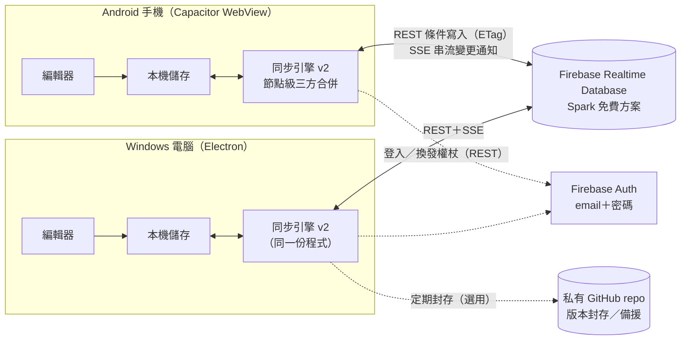

# MindFlow Android App ＋ 手機↔電腦即時雙向同步：架構與改造計畫（STAGE ①）

> 狀態：**計畫草案，尚未開發**。本文件只做架構評估與改造計畫，沒有修改任何程式、沒有部署、沒有建立任何雲端帳號或付費服務、沒有碰正式資料。
> 撰寫：Claude（主力開發 session），2026-10-13；依據 `main @ b6cc4c8` 的程式碼、`docs/` 既有文件、4 份平行調查（現有同步、行動端／Electron、資料模型、2026 年免費方案條款）。
> 情境：**單一使用者、多裝置**（你的 Android 手機 ↔ Windows 電腦），不是多人協作。

## 0. 決策摘要（先看這段）

| 問題 | 結論 |
|---|---|
| 手機 App 用什麼做？ | **Capacitor（已存在，繼續用）**：現有網頁 UI 原封不動跑在裡面，只需升級到 Capacitor 8、補齊返回鍵／背景存檔／匯出分享／備份等原生功能。不換技術。 |
| 現在最急的問題？ | **手機 App 目前每次更新都必須解除安裝（會刪光手機上的資料）**：CI 每次用隨機金鑰簽章、版號固定。這是 M1 第一件事。 |
| 即時同步用什麼？ | **推薦：Firebase Realtime Database（免費 Spark 方案）＋Firebase 帳號（email/密碼）**，而且**不用 Firebase SDK**，直接用官方 REST API 與 SSE 串流，維持專案「零依賴」原則。另一個完整比較過的方案是 **Cloudflare Workers + Durable Objects**（同樣 $0、不綁卡）。 |
| 衝突怎麼處理？ | 從「整份文件誰新誰贏＋衝突副本」升級為 **節點層級三方合併**：不同節點的修改自動合併；同一節點同一欄位兩邊都改才算真衝突，用混合邏輯時鐘決定勝方，**輸方內容保留在衝突紀錄，不會默默消失**。 |
| 能做到多即時？ | **兩台都在前景、有網路時：節點編輯完成後約 1–3 秒出現在另一台，不重新載入頁面**。手機 App 在背景時 Android 會暫停 WebView，回到前景後 1–2 秒內補齊。要在背景也被喚醒，需要 FCM 推播加上一個送通知的小伺服器（Cloudflare Worker 免費額度可做到，但多一個要維護的元件），列為日後選項。 |
| 免費做不到時的備案？ | 沿用現有 GitHub 同步，但改成「存檔後數秒推送＋ETag 輪詢（＋選用 ntfy 門鈴）」，延遲約 5 秒到 1 分半（看有沒有門鈴、是否連續編輯），$0、零新帳號（3.8）。 |
| 每月要花多少？ | **每月持續 $0、一次性必要支出 $0**（選用：Google Play 上架 US$25，不建議）。見第 5 章。 |
| 要多久？ | 5 個里程碑（M2 分 a、b 兩段），約 **29–38 個開發工作天**，含你的實機驗收來回約 **6–8 週**。見第 4、5 章。 |
| 需要你做什麼才能進 STAGE ②？ | 只要回覆「同意推薦方案」或指定其他方案。開發全程先用 **Firebase 本機模擬器**（不需帳號、不碰真資料）；最後才需要你花 15–30 分鐘建立免費 Firebase 專案（不需信用卡）。 |

### 本 PR 範圍

- ✅ 只新增本文件 `docs/android-sync-plan.md`。
- ❌ 不改程式、不 merge 到 main、不發版（文件只動 `docs/`，release 工作流程本來就忽略 `docs/**`）、不建立雲端專案、不開通付費服務。

### 目錄

1. [現況架構](#1-現況架構2026-10-13main--b6cc4c8)
2. [Android 改造評估](#2-android-改造評估)
3. [即時同步架構](#3-即時同步架構以不花錢為主軸)
4. [分階段開發計畫與里程碑](#4-分階段開發計畫與里程碑)
5. [成本／工作量／時程估計](#5-成本工作量時程估計)
6. [風險與未決問題（含假設）](#6-風險與未決問題含假設)
7. [附錄：來源](#7-附錄來源2026-10-13-查證)

## 1. 現況架構（2026-10-13，main @ b6cc4c8）

> 本章全部來自讀程式碼與既有文件；「推論」標記的是從程式路徑推得、尚未實測的結論。

### 1.1 技術棧

| 層 | 技術 | 位置 |
|---|---|---|
| 編輯器／首頁 | Vanilla JS（ES2022 modules）+ HTML + CSS，**零框架、零打包器、零 npm runtime 依賴** | `index.html`、`editor.html`、`js/`、`css/`（約 2 萬行） |
| 繪圖 | 節點＝絕對定位 div；連線＝SVG；文字編輯＝contenteditable；Command Pattern 做 undo/redo | `js/editor/render.js`、`commands.js`、`edit.js` |
| 本機儲存 | `localStorage`（同步 API），桌面與手機都一樣 | `js/store.js` |
| 桌面版 | Electron 43.3.0 殼，自訂 `mindflow://app` 協定、NSIS 安裝檔＋免安裝 exe | `desktop/` |
| 手機版 | **Capacitor 6.2.1** Android 殼（已存在），唯一外掛 `@capacitor/preferences` 6.0.4；minSdk 22、compile/targetSdk 34、JDK 17、AGP 8.2.1 | `mobile/` |
| 同步 | 私有 GitHub repo 當雲端中樞，三方合併；桌面在 main process、手機在 WebView 內 | `js/sync-plan.mjs`（共用純函數）、`desktop/sync-engine.mjs`、`js/sync-mobile.mjs` |
| CI／發版 | GitHub Actions：`release.yml`（Windows 安裝檔，版號 `1.0.<run>`）、`android.yml`（`MindFlow.apk`），都上傳到 rolling `latest` release；桌面版自動更新讀這個 release | `.github/workflows/` |

### 1.2 心智圖資料怎麼存

**格式**：每份文件是一個 JSON（`js/editor/model.js` 的 `normalizeDoc`／`normalizeNode`）。

```text
Doc  { id:'doc_<16碼>', title, createdAt, updatedAt(ISO, 每次存檔用本機時鐘重蓋),
       root: Node, layout, themeId, relations[], summaries[],
       canvas{background, watermark{…}, spacingH, spacingV}, thumbnail(SVG, 約 2KB) }
Node { id:'node_<16碼>', text, richText(HTML|null), children[](順序有意義), collapsed,
       side, style{18 個白名單 key}, notes, link, icons[], image{src(data URI),w,h}|null }
```

**位置（localStorage key）**：

| key | 內容 | 會同步嗎 |
|---|---|---|
| `mindflow.docs.index` | 文件目錄 `{version:2, docs[], trash[], favorites[]}`，含縮圖 | 會（由 manifest 重建） |
| `mindflow.doc.<id>` | 完整文件 JSON | 會（整份） |
| `mindflow.history.<id>` | 最多 30 份版本快照（每份是完整文件，含圖片） | **不會** |
| `mindflow.gamma.<id>` | 版面覆寫、單節點結構、`timeline-v` | **不會**（見 6.1 R7） |
| `mindflow.viewmode.<id>`、`mindflow.theme.*`、`mindflow.colors.recent`、`mindflow.minimap.open` | 檢視狀態、自訂主題、偏好 | **不會** |

**大小特性**：新文件的預設範本（中心主題＋4 個分支）含縮圖約 3.4 KB（縮圖約 2 KB），完全空白的文件不含縮圖約 0.5 KB；一個空節點約 160 B；推論 500 節點純文字約 90–110 KB。**圖片是 data URI 直接嵌在文件裡**：從 UI 插入的圖會重新編碼到長邊 1280 px、上限 512K 字元（約 384 KiB），但從檔案匯入的圖沒有上限，而且每份版本快照都會再存一次。

**對同步重要的模型事實**：

- 節點 id 是 `crypto` 隨機 16 碼，**在同一份文件內穩定**（改字、改樣式、拖曳移動、上下移都不變），但**不是全域唯一**：衝突副本與 `.mindflow` 匯入會沿用原節點 id。剪下貼上、複製、還原歷史版本會產生新 id（對合併器而言等於「刪除＋新增」）。
- **沒有任何節點層級的時間戳／版本、文件也沒有 `schemaVersion`**；唯一的時鐘是文件的牆鐘 `updatedAt`。
- `normalizeDoc`／`normalizeNode` 是**嚴格白名單**：不認得的欄位每次載入/存檔都會被丟掉。新舊版 App 混用時，舊版會默默刪掉新欄位。
- Command 是 do/undo 閉包，不是資料，無法直接序列化成操作日誌；但 `CommandManager.onChange` 是集中的掛鉤點，可以在這裡做差異比對。

### 1.3 既有的跨裝置同步（Stage A + C，已上線）

- **後端**：使用者自己的**私有 GitHub repo**（例如 `jason4233/mindflow-data`），根目錄 `manifest.json`＋每份文件一個 `docs/<id>.json`；透過 Git Data API（blob/tree/commit/ref）讀寫，每次推送是一個 commit，所以 git 歷史保有每一版。
- **登入**：fine-grained PAT（Metadata: Read、Contents: Read & write）。桌面用 Electron `safeStorage` 加密存檔；**手機存在 Capacitor Preferences（Android SharedPreferences，明文）**。
- **合併**：`js/sync-plan.mjs` 純函數，**以整份文件為單位**的三方合併（local × remote × base）。兩邊都改同一份文件 → 牆鐘 `updatedAt` 較新者贏、輸方變成「衝突副本」新文件；垃圾桶、收藏、永久刪除（tombstone）分開合併。四大不變式寫在 `docs/PHASE_SYNC_BRIEF.md`：state-based 三方合併、pull-before-push、**永不靜默丟資料**、**雲端中樞制（機器之間零直接通訊，任何一台關機都不影響其他機器）**。
- **觸發時機與延遲**：

| | 桌面（`desktop/sync-engine.mjs`） | 手機（`js/sync-mobile.mjs`） |
|---|---|---|
| 推送 | 每 15 秒比對指紋，有變更後**等 45 秒**沒有新修改才推（沒有最長等待上限） | 每次寫入 localStorage 後**等 45 秒**（沒有上限） |
| 拉取 | 每 5 分鐘 ETag 條件請求（304 不算額度）；視窗取得焦點（10 秒節流）；啟動；關窗 | 啟動／每次換頁（整套重跑一次）；回到前景；**前景時不會自動拉** |
| 失敗重試 | 30 秒起倍增到 5 分鐘 | **沒有**（設定畫面卻寫「恢復網路後會自動重試」） |

- **推論的端到端延遲**：手機改 → 電腦看到，通常 1–6 分鐘（電腦視窗被點到時約 50 秒），最差沒有上限（手機在推送前就鎖螢幕或進背景）。電腦改 → 手機看到：電腦 45–60 秒後才推，正在前景顯示同一份圖的手機**不會自己更新**，要等下次換頁或回前景。
- **套用遠端變更**：送出 `mindflow:sync-applied` 事件；編輯器若沒有未存修改就 **整頁重新載入**（失去 undo、選取、視角），有未存修改就跳出 CAS 衝突橫幅。

**已知問題（調查發現，尚未修）**：

1. **同步期間的競爭條件**：同步先讀一次 localStorage 快照、走網路幾秒、再無條件寫回被拉下來的文件與整份重建的 index；編輯器存檔不經過同步佇列。期間存的修改可能被覆蓋、新文件可能從 index 消失（推論，未測）。
2. 「以我為準覆蓋」按鈕會蓋掉剛拉下來的版本且**不留衝突副本**，違反不變式 3（推論）。被蓋掉的版本其實還在 GitHub 的 commit 歷史裡，不是永久遺失，但你看不到、也不知道要去找。
3. 推送成功但本機 base 沒存到（App 被殺、換頁）時，下次同步會產生內容相同的衝突副本（推論）。
4. 桌面每次推送後的第一次輪詢一定拿到 200（ETag 是推送前的），白跑一次完整同步。
5. 手機 WebView 的 `fetch` 沒設 `cache: 'no-store'`，GitHub 回應帶 `Cache-Control: private, max-age=60`，可能讀到 60 秒前的分支頭（推論，未驗證）。
6. 桌面與手機各自複製了一份 GitHub 客戶端與協調流程（`sync-engine.mjs` vs `sync-mobile.mjs`），任何修改要做兩次。
7. 桌面的同步警告（公開 repo、隔離文件）被 preload 濾掉，UI 收不到（推論）。

- **GitHub 作為即時通道的硬上限**：主要額度 5,000 次/小時（同一使用者所有裝置共用）；**次級限制約每分鐘 80 次、每小時 500 次「建立內容」請求**。一次單文件推送約 5 次寫入（2 blob + tree + commit + ref），所以整個帳號**每小時最多約 100 次推送**；而且每次推送都要改同一個 `manifest.json`，兩台同時推一定撞 422 重試。→ GitHub 適合當「幾十秒級」的同步與版本封存，**不適合當逐字即時通道**。

### 1.4 Electron 桌面專屬功能與手機替換對照

| 桌面功能 | 位置 | 手機現況 | 計畫中的替換 |
|---|---|---|---|
| 固定來源 `mindflow://app` 協定（localStorage 不會因埠號變動遺失） | `desktop/main.mjs`、`protocol.mjs` | Capacitor 預設 `https://localhost` | 沿用；**鎖死 hostname/scheme**，改了會讓資料「消失」（新來源） |
| 每 2 分鐘磁碟備份 ×10 份、空儲存時自動還原 | `desktop/backup-store.mjs` | **無** | `@capacitor/filesystem` 定期備份到 App 私有目錄＋可匯出（M1） |
| 舊來源資料遷移 | `desktop/legacy-storage.mjs` | 不需要 | localStorage → IndexedDB 遷移時要寫一份同等的遷移（M4） |
| 單一實例＋喚回視窗 | `main.mjs`、`window-focus.mjs` | `launchMode="singleTask"` | 沿用 |
| 自動更新（讀 GitHub `latest` release、靜默安裝） | `desktop/updater.mjs` | **無；而且每次 CI 用隨機金鑰簽章、versionCode 固定 1 → 新版裝不上去，只能解除安裝（會刪光資料）** | 固定 release keystore（GitHub Secrets）、versionCode 自動遞增、App 內檢查更新並導向下載（M1，最優先） |
| PAT 加密（`safeStorage`） | `desktop/sync-settings.mjs` | Preferences 明文、`allowBackup="true"` | 安全儲存外掛（Android Keystore）＋關閉或限縮 Auto Backup（M1） |
| 同步引擎跑在 main process、用 `executeJavaScript` 讀寫 renderer | `desktop/sync-engine.mjs` | WebView 內 `js/sync-mobile.mjs`（另一份實作） | 合併成**一份 renderer 端同步核心**，桌面也改在 renderer 跑；Electron 只提供憑證存取與關窗 flush（M2a） |
| 關窗前先存檔＋備份＋同步 | `main.mjs`、`sync-engine.mjs` | **無**（沒有 `@capacitor/app`，進背景不 flush） | `appStateChange`／`visibilitychange` 時立即存檔＋推送（M1） |
| 匯出用 `<a download>`、列印用 `window.open`+`print()` | `js/editor/exportdialog.js` | **都沒作用**（Capacitor 沒有下載處理、不支援新視窗） | `@capacitor/filesystem` 寫檔＋`@capacitor/share` 分享；PDF 改成產生檔案後分享（M4） |
| CSP 標頭＋meta | `desktop/protocol.mjs` | 只有 meta，`copy-web.mjs` 建置時把 `connect-src` 改寫為加上 `https://api.github.com` | M3 在三處（`desktop/protocol.mjs`、兩個 HTML 的 meta、`copy-web.mjs` 的改寫比對字串）同一個 commit 加入 Firebase 網域（清單見 3.2.3） |
| 導覽守門、外部連結開瀏覽器 | `main.mjs` | Capacitor 預設把外部網域交給系統瀏覽器 | 沿用 |

### 1.5 既有 Android App 的成熟度

**已有**：CI 自動產出可安裝的簽章 APK（約 3.5 MB）；觸控手勢引擎（單指平移、雙指縮放、點選、雙擊編輯、雙擊空白建懸浮節點、長按節點選單、拖曳重掛、選取後浮出「＋子節點／＋同級」）；行動版工具列、底部 6 鈕工具欄、全螢幕側欄抽屜、文字工具列貼齊軟鍵盤；手機端 GitHub 同步。

**缺口（依每天使用的影響排序）**：

1. **更新會毀資料**：隨機簽章＋固定 versionCode → 只能解除安裝再裝，localStorage 與 PAT 全清空。
2. **手機上沒有任何耐久備份**：資料只在 WebView localStorage（推論上限約 10 MiB UTF-16，約 520 萬字元），30 份快照×內嵌圖片很快就逼近上限；沒有磁碟備份。
3. **同步不即時也不夠穩**：見 1.3。
4. **返回鍵直接關掉 App**；進背景不存檔（推論最多約 4 秒的修改可能遺失）。
5. **匯出／分享／PDF 不能用**。
6. **平台版本老舊**：Capacitor 6、targetSdk 34；Google Play 自 2026-08-31 起要求新 App／更新 targetSdk 36（側載不受此限，但 targetSdk 35 起會強制 edge-to-edge，而 `viewport-fit=cover` 尚未設定）。
7. **很多功能在手機上碰不到**：演示模式、概要、關聯線、格式刷、多選、全部展開/收合、上下移、複製等只能用鍵盤或被隱藏的工具列；首頁的漢堡抽屜程式碼存在但沒掛上。
8. **編輯手感**：編輯中的節點不會自動捲到鍵盤上方；Android 輸入法組字從未在實機驗證（桌面版曾為 IME 修過很多輪）。
9. **憑證輸入困難**：在手機上手打 fine-grained PAT 很痛苦，而且明文存放。
10. **從未在實體手機上驗證**：所有驗證都是 Chromium 375×812 模擬；手勢參數沒在實機調過；根目錄的單元測試與觸控 E2E 沒有跑在任何 CI。

## 2. Android 改造評估

### 2.1 結論：Capacitor 可行，而且已經是現況——繼續用，升級並補齊

- **可行性已被證明**：現有網頁 UI 不改一行就跑在 Capacitor 裡，建置只是「複製檔案＋改寫 CSP」，CI 已能產出可安裝 APK。
- **不需要打包器也能用外掛**：Capacitor 會在原生端產生 `window.Capacitor.Plugins.<名稱>` 代理，現有的 Preferences 已經這樣用（`js/sync-mobile.mjs`）。所以「零 npm runtime 依賴、零打包器」的原則可以維持：網頁程式只透過全域代理呼叫，npm 套件只存在於 `mobile/` 的原生建置端。
- **所有缺口都有官方或成熟的外掛**：`@capacitor/app`（返回鍵、前景/背景、深層連結）、`@capacitor/filesystem` + `@capacitor/share`（匯出）、`@capacitor/keyboard`、`@capacitor/network`、`@capacitor/status-bar`、安全儲存（社群外掛，走 Android Keystore）。
- **替代方案都更差**：PWA/TWA 會失去原生儲存與外掛、而且背景限制更多；React Native／Flutter 要重寫整個以 DOM 為基礎的編輯器（數月工作量）。

**結論：不換技術，採「Capacitor 升級＋補齊」。**

### 2.2 平台升級

| 項目 | 現況 | 目標 | 理由 |
|---|---|---|---|
| Capacitor | 6.2.1 | **8.x**（2026-10 最新 8.5.3；9 仍在 alpha） | 跟上 targetSdk 要求與外掛相容性 |
| JDK | 17 | 21 | Capacitor 8／新版 AGP 要求；CI 只需改 `setup-java` |
| targetSdk / compileSdk | 34 / 34 | 36 / 36 | Capacitor 8 預設值；Google Play 2026-08-31 起要求 36；側載可暫緩但會累積技術債 |
| minSdk | 22 | 24（Capacitor 8 下限；假設 A4：你的手機是 Android 7 以上） | 程式已用 `Object.hasOwn`（Chrome 93+）、`.at()`（92+）、`100dvh`（**108+**）；`minWebViewVersion` 設 108，或替 `dvh` 加 `vh` 後援 |
| Edge-to-edge | 未處理 | `viewport-fit=cover`＋已存在的 `env(safe-area-inset-*)` 生效 | targetSdk 35 強制 edge-to-edge |
| 簽章 | 每次 CI 隨機產生金鑰 | **固定 release keystore**，存在 GitHub Actions Secrets；`.gitignore` 確保金鑰不入庫 | 能覆蓋安裝 = 更新不刪資料 |
| versionCode | 寫死 1 | CI 用 `github.run_number` 自動遞增 | Android 不允許相同或更小的版號覆蓋 |

### 2.3 為手機調整的清單

**觸控／操作**

- 補齊手機上碰不到的功能：長按空白處叫出畫布選單（全部展開/收合、貼上、新增懸浮節點）；長按節點選單加入「概要、關聯線、上移/下移、複製」；底部工具欄的「更多」抽屜放演示模式、格式刷、尋找。
- 觸控多選：長按節點進入「多選模式」，之後點選切換選取。
- 收合按鈕在觸控環境改成常駐顯示（目前只在 hover 時出現）。
- 備註預覽：觸控上點一下圖示開啟（目前是 hover 預覽）。
- 編輯中的節點自動捲到軟鍵盤上方（`visualViewport` 已經在算鍵盤高度，補上「把節點平移進可視區」）。
- 手勢參數（雙擊間隔、長按時間、點按容忍距離）在實機上調校。

**版面**

- 首頁掛上已寫好但沒接上的漢堡抽屜（`js/editor/mobilechrome.js` 的 dashboard 部分）。
- 分屏參考在手機上停用或改成全螢幕切換（WebView 不能顯示 blob PDF）。
- 實機驗證橫向／直向切換、平板寬度、深色模式系統列顏色。

**Electron API 替換與 App 生命週期**

- `@capacitor/app`：返回鍵在編輯器 → 回首頁、在首頁 → 再按一次離開；`appStateChange` 進背景時**立即存檔＋推送**、回前景時拉取。
- 匯出：產生 Blob → `Filesystem.writeFile`（App 快取目錄）→ `Share.share` 讓使用者存到雲端硬碟或傳給自己；列印/PDF 改成產生檔案後分享。
- 匯入：保留 `<input type=file>`，`.mindflow` 補上 MIME 對應，避免檔案選擇器把它濾掉。
- 憑證：同步權杖改存 Android Keystore 支援的安全儲存；`allowBackup` 改為排除敏感檔案或關閉。
- 儲存：localStorage → IndexedDB（非同步、配額遠大於 localStorage），手機與桌面同一套（M4，見第 4 章）；在那之前先做定期檔案備份（M1），並把同步層的圖片改成獨立資產（M2a），減輕 localStorage 壓力。
- 更新：App 內讀 GitHub `latest` release 的版本號，有新版就提示並開啟 APK 下載頁（側載無法靜默安裝，需使用者確認，這是 Android 的安全限制）。

### 2.4 發佈方式

- **主路線：繼續側載 APK**（GitHub release `latest`），$0。
- **Android 開發者驗證制度**（見 6.1 R3）：2026-09-30 起先在巴西、印尼、新加坡、泰國實施，而且目前只檢查從參與計畫的合作商店（名單見官方頁）安裝的 App，官方 FAQ 明說「使用者直接側載的 App 暫不適用」；全球推行訂在 **2027 年**（未公布日期與國家名單），**台灣目前未被點名**。對策：(1) 現在不用做任何事；(2) 2027 前用**免費的「限量發佈」帳號**（需 Google 帳號開兩步驟驗證＋付款資料檔，最多 20 台受邀裝置，不需身分證件）登記套件名稱 `com.mindflow.app`；(3) 備援：**`adb install` 安裝不需要驗證**（官方明文豁免）。
- **Google Play**：一次性 US$25 註冊費（**選用，不建議**）。上架需 targetSdk 36、隱私權政策、資料安全表單；2023-11 之後建立的個人帳號還要先完成封閉測試期。單人自用沒有上架的必要。

## 3. 即時同步架構（以不花錢為主軸）

### 3.1 需求與約束

- **使用情境**：一個人、2–3 台裝置（手機＋電腦，可能再加一台筆電）。不是多人協作，所以不需要多人游標、權限分享。
- **費用**：每月 $0，最好連信用卡都不用綁（綁了卡就有被意外收費的可能）。
- **延續既有四大不變式**（`docs/PHASE_SYNC_BRIEF.md`）：
  1. state-based 三方合併（不是操作日誌）；
  2. 先拉再推、衝突重試；
  3. **永不靜默丟資料**；
  4. **雲端中樞制**：機器之間零直接通訊，任何一台關機都不影響其他機器同步。→ 「自架在常開電腦」會違反這條（電腦關機手機就同步不了），所以只列為參考（3.4）。
- **本機優先（local-first）**：本機永遠可以編輯，離線照常使用，網路恢復後自動補同步。
- **維持零 runtime 依賴**：同步只用瀏覽器內建的 `fetch`、`EventSource`（SSE）、`WebSocket`、`WebCrypto`，不引入 SDK 與打包器。
- **「即時」的定義（假設 A1）**：兩台都開著 App、在前景、有網路時，**一個節點編輯完成（按 Enter／點旁邊）後，另一台在約 3 秒內看到（95% 的情況下），而且不重新載入頁面**。逐字同步（打字中途就出現在另一台）不是目標。

### 3.2 推薦架構：Firebase Realtime Database（REST＋SSE，零 SDK）



**為什麼是它**：免費 Spark 方案**不需要付款方式**、**沒有閒置暫停**、配額對單人用量綽綽有餘（3.2.4）；官方 REST API 原生支援 **SSE 即時串流**與 **ETag 條件寫入**（只有雲端版本沒被另一台改過時才寫入，避免互相覆蓋），所以不用裝 Firebase SDK，維持零依賴。

#### 3.2.1 元件

1. **同步引擎 v2（一份程式，桌面與手機共用）**：放在 `js/sync/`，在 renderer（網頁端）執行。取代現在桌面 `desktop/sync-engine.mjs` 與手機 `js/sync-mobile.mjs` 兩份重複實作。Electron main process 只負責「安全保存憑證」與「關窗前 flush」。
2. **傳輸介面（Transport）**：`listManifest / getDoc / putDoc(條件寫入) / putAsset / getAsset / subscribe(變更通知)`。實作三種：
   - `FirebaseTransport`（主要，即時）；
   - `GitHubTransport`（把現有 Git Data API 程式重構進來；作為封存與備援）；
   - 若改選方案 B，則是 `CloudflareTransport`。
   換後端只換這一層，合併與儲存邏輯不動。
3. **合併核心**：純函數 `js/sync/merge-doc.mjs`（節點級三方合併，3.7），沿用 `js/sync-plan.mjs` 處理文件清單、垃圾桶、收藏、永久刪除。
4. **base 儲存**：每份文件「上次同步成功的版本」（三方合併必需），放 IndexedDB（避開 localStorage 配額）。
5. **資產快取**：同步層把圖片抽出來（3.2.2），本機依 SHA-256 快取。

#### 3.2.2 雲端資料配置

```text
/users/{uid}/
  meta/                                  ← 唯一被 SSE 串流訂閱的節點（資料很小）
    schemaVersion: 2
    manifest/{docId}:  { title, createdAt, state:'active'|'trashed', deletedAt?, rev, hlc, writer }
    favorites/{docId}: true
    tombstones/{docId}: "<purgedAt ISO>"
  docs/{docId}:     { rev, hlc, writer, body: "<去掉圖片後的文件 JSON 字串>" }
  assets/{sha256}:  "<data URI>"        ← 內容不變；沒有任何文件引用時定期回收
```

- **文件內容存成字串**：Realtime Database 會把陣列轉成物件、key 不能含 `. $ # [ ] /`；存字串可保證 JSON 原樣往返，也方便日後加端對端加密（6.2 A12）。
- **圖片在同步層抽出來**：上傳前把 `image.src` 的 data URI 換成 `mf-asset:<sha256>`，圖片另存 `assets/`；下載後再換回 data URI 寫進本機。**本機儲存格式與匯出功能完全不變**，但每次同步只傳文字結構（數 KB–數百 KB），不會每改一個字就重傳好幾 MB 的圖片。
- **收藏與永久刪除放在 `meta/` 底下**：和文件清單一起被串流，所以也是即時同步。
- **資產的大小與清理**：單一字串上限 10 MB，而從檔案匯入的圖片沒有大小限制。所以同步層上傳前，會把超過 2 MB 的圖片重新編碼到 2 MB 以內，做不到就提示並跳過該圖（文件其餘部分照常同步）。電腦端定期回收 30 天沒被任何文件引用的資產，避免逐漸吃掉 1 GB 額度。
- **安全規則**（一份 JSON，放進 repo 並用模擬器測試）：`/users/$uid` 只允許 `auth.uid === $uid` 讀寫。

#### 3.2.3 同步流程

**本機有修改**

1. 編輯器提交修改（`CommandManager.onChange`）→ 等 1 秒沒有新修改才送（連續修改最多等 3 秒）。
2. 抽出圖片；遠端沒有的資產先上傳。
3. `PUT docs/{id}`，帶上次讀到的 ETag（`if-match`）。
4. 成功 → 更新 `meta/manifest/{id}` 的 `rev/hlc` → 這一版成為新的 base。
5. 回 `412`（遠端已被另一台更新）→ 讀遠端 → 三方合併 → 寫回本機 → 再送一次（有上限）。

**遠端有修改**

1. 每台裝置用 SSE 訂閱 `meta`（文件清單、收藏、永久刪除都在裡面，資料很小）。
2. 某份文件的 `rev` 跟本機 base 不同 → `GET docs/{id}` → 補抓缺的圖片 → 與 base、本機三方合併。
3. 寫本機；**這份文件正開著就「就地套用」（不重新載入）**；合併結果和遠端不同就推回去。

**斷線與補齊**

- `EventSource` 斷線會自動重連。
- 收到 `auth_revoked`（權杖過期）→ 換發新權杖後重連。
- `online` 事件、App 回前景、啟動時 → 完整核對一次 manifest，把待上傳與待下載都補齊。
- 寫文件與寫 manifest 不是同一個原子操作：Realtime Database 的多路徑原子寫入不能搭配 `if-match` 條件寫入，兩者只能擇一。對策有兩層：
  - 寫入方持久化「manifest 待補寫」旗標，下次補寫。
  - **任何一台**在完整核對時，都會逐份讀 `docs/{id}/rev`（只有幾十 bytes，不下載內容）。發現比 manifest 新就自行補寫 manifest，不必等原寫入方回來。

**網域白名單（CSP）**

- `connect-src` 要加入四個網域：
  - `https://*.firebasedatabase.app`、`https://*.firebaseio.com`：SSE 串流會用 307 轉址到另一台主機，而 CSP 檢查的是轉址後的目標，所以兩者都要列。
  - `https://identitytoolkit.googleapis.com`、`https://securetoken.googleapis.com`：登入與換發權杖。
- `mobile/scripts/copy-web.mjs` 會比對 HTML 裡的原字串，所以 HTML meta 與改寫規則要在同一個 commit 一起改。

#### 3.2.4 延遲預算與用量估算

| 步驟 | 時間（估計） |
|---|---|
| 提交後等修改停下來（debounce） | 1 秒（連續修改最多 3 秒） |
| `PUT` 文件＋manifest | 0.3–0.8 秒 |
| SSE 通知抵達另一台 | 0.1–0.3 秒 |
| `GET` 文件 | 0.2–0.5 秒 |
| 合併＋重繪 | < 0.1 秒 |
| **合計** | **單次修改約 1.6–2.7 秒，目標是 95% 的情況下 ≤ 3 秒**；連續快速修改時因最長等待 3 秒，約 3.6–4.7 秒（假設資料庫選新加坡區 `asia-southeast1`，假設 A13） |

| Spark 免費上限 | 本專案估算用量 | 餘裕 |
|---|---|---|
| 儲存 1 GB | 文件（去圖後）數 MB＋圖片資產數十 MB | 大 |
| 下載 10 GB/月 | 假設每天 300 次遠端更新 × 每次 100 KB × 2 台 ≈ 1.8 GB/月 | 約 5 倍 |
| 同時連線 100 | 2–3 | 大 |
| 單次寫入 REST 256 MB；單一字串 10 MB | 文件去圖後通常 < 1 MB | 大 |

**超過配額會怎樣**：Spark 沒有綁付款方式。官方 FAQ 說超過時 App 會在**當月剩餘時間被停用**，**不會產生費用**。引擎偵測到後的處理：

- 電腦自動退回 GitHub 傳輸。
- 手機若有設定選用的備援 PAT（3.5），也退回 GitHub；沒有的話，先離線編輯、排隊，等 Firebase 恢復。
- 設定頁會顯示警告（6.1 R1、R10）。

### 3.3 兩個主要方案比較

| | **A. Firebase Realtime Database（推薦）** | **B. Cloudflare Workers ＋ Durable Objects** |
|---|---|---|
| 月費 | $0（Spark） | $0（Workers Free） |
| 需要信用卡 | 不需要（官方：Spark 不需付款方式） | 不需要（依第三方說明，官方未明文） |
| 閒置暫停 | 無 | 無 |
| 即時性 | SSE 串流，不到一秒 | WebSocket（Hibernation API），不到一秒 |
| 伺服器程式 | **不用寫**，只有一份安全規則 JSON | **要寫並部署**約 200–300 行 Worker＋Durable Object（用 `wrangler`） |
| 帳號／登入 | Firebase Auth email＋密碼（REST），權杖每小時自動換發、可重設密碼 | 自己做：配對時產生長隨機權杖，Worker 驗證；要撤銷就換權杖 |
| 衝突／一致性 | 客戶端三方合併＋ETag 條件寫入防止覆蓋 | 客戶端三方合併；Durable Object 單執行緒，可在伺服器端保證寫入順序 |
| 離線 | 兩案相同：本機優先＋待上傳佇列（3.6） | 同左 |
| 大小限制 | 單一字串 10 MB、REST 單次寫入 256 MB | 每列／每個值 2 MB，大文件要切塊；WebSocket 訊息 32 MiB |
| 免費配額 | 1 GB 儲存、10 GB/月下載、100 連線 | 每天 10 萬次請求、整個帳號 5 GB 儲存（單一 Durable Object 免費最多 1 GB）、每天 13,000 GB-s 時長 |
| 綁定程度 | 高（Firebase 專屬 REST），但資料簡單，可整棵 JSON 匯出 | 中（DO API 專屬，但程式碼少，好搬家） |
| 開發／測試 | Firebase 本機模擬器（不需帳號） | `wrangler dev` 本機模擬（不需帳號） |
| 主要風險 | Google 調整免費方案（2024–26 年已改過 Storage 與 email 連結登入額度）；WebView 內不能用 Google 登入（所以用 email＋密碼） | DO 免費層 2025-04 才推出，較新；伺服器程式要自己維護；權杖安全全靠自己 |
| 實作量（估計，只算傳輸層） | 4–6 天 | 5–8 天 |

> 實作量只算傳輸層本身；M3 另外還包含登入介面、QR 配對、CSP、首次搬家與備援切換，所以 M3 整體估 6–8 天。

**選 A 的理由**：不用寫、不用維護伺服器程式；有現成的帳號系統（密碼重設、權杖過期）；Realtime Database 的 REST/SSE 介面多年穩定；免費額度對單人用量餘裕大。**B 是很好的備選**：如果你不想用 Google 的服務、或 Firebase 免費方案未來變差，傳輸層抽象化後換成 B 的成本只有 B 本身的實作量。

### 3.4 其他評估過但不推薦的方案

| 方案 | 不推薦主因 |
|---|---|
| **Supabase Free** | **連續 7 天沒有資料庫請求就暫停專案**（出國一趟回來就不能同步，要手動回控制台恢復；官方說每天有幾次資料庫請求就不會暫停，但這等於要有一台機器每天保證上線去打 ping，仍不符合不變式 4）；流量 5 GB/月且所有服務合計；資料庫變更推播在 payload 過大時，超過 64 bytes 的欄位會被省略，只能當「門鈴」用。 |
| **Firebase Cloud Firestore** | 單一文件上限 1 MiB（三張圖就超過）；Cloud Storage 現在必須升級 Blaze（綁付款）；官方 SDK 需要打包或從 gstatic 載入；我們本來就是本機優先，用不到它的離線快取。 |
| **自架在常開電腦**（PocketBase／CouchDB＋Tailscale） | 違反不變式 4（電腦關機或睡眠，手機就同步不了）；手機必須常駐 Tailscale VPN（Android 同時只能開一個 VPN）；Cloudflare Tunnel 具名通道需要自有網域（年費）。 |
| **CRDT（Yjs／Automerge）** | Yjs 核心約 28 KB gzip，本身可行，但：樹狀節點「移動」沒有原生支援、要改寫所有 command 與 undo、要引入第三方程式碼、資料模型大遷移。單人多裝置的修改多半是先後發生，節點級三方合併已足夠（3.7），CRDT 留作日後選項。Automerge 的 WASM 約 1.1 MB gzip，太重。 |
| **純 P2P（y-webrtc 等）** | 兩台必須同時在線，違反不變式 4；行動網路 NAT 常需要付費 TURN 中繼。 |

### 3.5 帳號／登入

**推薦方案 A：Firebase Auth（email＋密碼，走 REST，零 SDK）**

- **一次性設定**（M3 最後由你操作，約 15–30 分鐘，會附圖文步驟）：
  1. 在 Firebase 主控台用你的 Google 帳號建立專案，選 Spark 免費方案（不需付款方式）。
  2. 啟用「電子郵件／密碼」登入，建立唯一一個使用者（你的 email）。
  3. 建立 Realtime Database（新加坡區；若免費方案不能選，就用美國 `us-central1`，假設 A13）。
  4. 貼上 repo 裡的安全規則，**寫死只允許你的 uid 讀寫**。就算有人知道專案設定、自行註冊帳號，也讀不到你的資料。
- **App 端登入流程**：
  - 設定頁填入專案設定（`apiKey`、`databaseURL`）、email、密碼 → 呼叫 `accounts:signInWithPassword` 取得 ID token（1 小時有效）與 refresh token。
  - refresh token 安全保存：電腦沿用 Electron `safeStorage`；手機用 Android Keystore 安全儲存外掛。
  - 之後自動用 `securetoken` 端點換發，**不必再輸入密碼**。SSE 串流收到 `auth_revoked` 時也是換發後重連。
- **手機配對（第一個 QR）**：電腦設定頁顯示 QR code，**只含 `apiKey`、`databaseURL`、email，不含密碼與任何權杖**；手機掃描後只需輸入一次密碼。
- **為什麼不用 Google 登入**：Google 封鎖嵌入式 WebView 內的 OAuth（`disallowed_useragent`），Capacitor 與 Electron 都受影響，必須另裝原生外掛。email 連結登入在 Spark 每天只能寄 5 封，而且需要深層連結。email＋密碼最簡單、零依賴。
- **忘記密碼**：Firebase 內建重設信。
- **手機的 GitHub PAT 變成選用**（假設 A6）：
  - 電腦保留 PAT，做封存與備援。
  - 手機可以選擇用**另一個、選用的第二個 QR** 帶入一份 PAT。這個 QR 內含秘密，只在你按下按鈕時顯示，請在私下掃描。PAT 存進 Android Keystore 安全儲存，只在 Firebase 停用時才用得到。這個功能 M1 就先做好：M1 重新安裝後手機仍走 GitHub 同步，不用再手打 PAT。
  - 不設定的話，Firebase 停用期間手機只能離線編輯、排隊等待。
- **加固**：
  - 若主控台有「使用者動作 → 允許建立（註冊）」選項就關閉，防止別人用公開的 apiKey 自行註冊。
  - 主要防線仍是安全規則寫死你的 uid。
  - 請用長密碼，Firebase 內建登入嘗試節流。
- **`apiKey` 不是密鑰**：Firebase 的 apiKey 只是專案識別碼，真正的保護是「登入＋安全規則」。

**方案 B：Cloudflare（自建權杖）**

- 部署 Worker 時設定一組管理密鑰。
- 電腦端用它產生「裝置權杖」（長隨機字串，雜湊後存在 Durable Object）；手機掃 QR 取得自己的權杖。
- 每台裝置可單獨撤銷。沒有密碼重設這類流程，安全細節全部自己維護。

**3.8 GitHub 加速版**：維持現有 fine-grained PAT。手機上改成由電腦顯示 QR 帶入，不用手打。

### 3.6 離線處理（兩個方案共用）

- **本機永遠可寫**：編輯器只寫本機儲存，同步是背景工作，任何時候都不會擋住編輯。
- **待上傳佇列**：每份文件記錄「本機是否有未上傳修改」與「base 版本號」，持久化保存（M2a 起放 IndexedDB），App 被殺也不會遺失。
- **重連時機**：`online` 事件、App 回前景、SSE 重連成功、啟動時 → 完整核對：比對 `meta` 裡各文件的 `rev`，並逐份讀 `docs/{id}/rev` 抓出 manifest 沒更新到的文件，然後補上傳與補下載。
- **兩邊都離線各改各的**：重新連線後走三方合併（3.7），不同節點的修改全部保留，同欄位衝突保留輸方內容。
- **Android 背景限制**：App 進背景時 WebView 會被暫停，無法即時接收。對策是進背景前立即存檔並嘗試推送（`@capacitor/app` 的 `appStateChange`），回前景時立即補齊（約 1–2 秒）。要在背景被喚醒，需要 FCM 推播加上一個送通知的小伺服器（Cloudflare Worker 免費額度可做到，但多一個要維護的元件、手機還要裝推播外掛），列為日後選項（6.1 R2）。
- **狀態顯示**：同步列顯示「已同步／同步中／離線（N 份待上傳）／錯誤（原因）」；手機版「恢復網路後會自動重試」這句話改成真的會重試。

### 3.7 衝突解決：節點層級三方合併（兩個方案共用）

**為什麼要升級**：現在以整份文件為單位，只要兩台改過同一份心智圖（例如手機加了一個節點、電腦改了另一個節點的字），就會多出一份「衝突副本」要人工合併。即時同步之後兩台更常同時開著同一份圖，這種副本會變多。

**做法**：把文件攤平成「節點 id → 欄位」的對照表，拿 base（上次同步版）、本機、遠端三份比較：

| 情況 | 處理方式 |
|---|---|
| 只有一邊改了 | 直接採用該邊 |
| 兩邊改不同節點、或同節點不同欄位 | 全部保留（自動合併） |
| 同節點同欄位兩邊都改且值不同（文字、樣式某一項、備註、連結、圖片…） | 混合邏輯時鐘（HLC）較新者勝；**輸方的值寫入文件的「衝突紀錄」**，UI 顯示「本文件有 N 個合併衝突」，可一鍵還原 |
| 互相綁定的欄位群組：`text`＋`richText`、`image{src,w,h}`、懸浮圖座標 `x,y` | 整組一起判勝負，不拆開混搭（否則會出現純文字和格式化文字對不上的節點） |
| `collapsed`（展開／收合，本質上是檢視狀態） | 直接採較新的一邊，**不記入衝突紀錄**（避免每次摺疊都跳出「合併衝突」） |
| 子節點順序 | 每個父節點的子節點 id 序列做 diff3；無法乾淨合併時，以勝方順序為主，另一邊新增的節點接在後面 |
| 同一節點被兩邊移到不同父節點 | HLC 勝方；若造成循環（A 移到 B 下、B 移到 A 下），撤銷較晚的那次移動 |
| 一邊刪除子樹、另一邊在裡面新增或修改 | **被修改的節點不刪**：原父節點還在就留在原位，否則掛到一張「衝突暫存」懸浮圖 |
| 關聯線、概要 | 依 id 三方合併；指向已刪節點的參照清除並記入衝突紀錄 |
| 文件層級（標題、版面、主題、畫布、浮水印、間距） | 逐 key 三方合併 |
| 合併程式出錯、或對方 App 版本不相容 | 退回現有行為：產生整份「衝突副本」（安全網） |

**需要的資料模型調整**（第 4 章 M2a）：

- 文件加 `schemaVersion: 2` 與 `hlc`。
- **版本閘門必須比 v2 格式早一個版本上線**（6.1 R8）。現在的程式完全不看 `schemaVersion`：舊版會把 `conflicts[]`、`hlc` 這些新欄位當成不認得的欄位刪掉，再推回去。所以：
  - **M1** 就加入「manifest 或文件的 `schemaVersion` > 1 → 拒絕同步並提示更新」。
  - **M2a** 才開始寫出 v2。
  - M2a 發版前，手機與電腦都必須先更新到 M1 以後的版本（M1 本來就要重新安裝一次）；更早的版本無法被擋。
  - 新版引擎若發現已知是 v2 的文件被改回 v1，視為「降版」，兩份都保留。
- 文件加 `conflicts[]`（衝突紀錄，有上限、可清除）。
- 懸浮圖座標從 `icons` 裡的 `__floating__:x,y` 字串搬成正式欄位（否則「移動懸浮圖」和「加圖示」會在同一個陣列上衝突）。
- `style.lineStyle` 這種把線型、寬度、間距塞在同一字串的複合值，在合併層拆開逐項比較。
- 混合邏輯時鐘取代牆鐘：手機與電腦的系統時間可能差幾秒到幾分鐘，HLC 保證先後順序一致。
- 剪下貼上、複製、還原歷史會產生新 id，合併器會視為「刪除＋新增」，結果仍正確，只是不會被當成「移動」。

**編輯器就地套用遠端修改（不再整頁重載）**：

- 多個控制器共用同一個文件物件，所以要「原地」更新那個物件後重繪，保留視角與選取。
- 正在打字時先延後套用，等這個節點編輯完成（通常幾秒內）。
- 遠端修改套用到正開著的文件時，**清空 undo/redo**（假設 A9）。避免 undo 把剛同步來的內容蓋掉；單人多裝置很少同時在兩台編輯同一份圖，這個取捨可接受。

**測試策略**：合併核心是純函數，用「隨機編輯腳本」產生大量 base／本機／遠端組合（模糊測試），斷言四件事：不丟節點（除非兩邊都刪）、樹結構合法（無循環、無孤兒）、結果與合併順序無關、輸方值一定進衝突紀錄。

### 3.8 免費次佳備案：GitHub 加速版（不需任何新帳號）

**什麼時候用**：你不想註冊 Firebase 或 Cloudflare、或免費方案將來變差時。也是推薦方案出問題時的備援：電腦自動切換；手機需先帶入備援 PAT，否則離線排隊。

- 沿用現有私有 GitHub repo 與 PAT，套用同一套「同步引擎 v2＋節點級合併」。
- **推送**：存檔後等 5 秒、連續修改最多 30 秒，**兩次推送至少間隔 60 秒**。GitHub 次級限制約每小時 500 次「建立內容」請求，一次推送約 4–5 次寫入：間隔 60 秒＝每小時最多 60 次推送、約 300 次寫入，低於上限，也遠低於官方建議的每個 repo 每分鐘 6 次推送。（間隔 30 秒會到每小時約 600 次寫入，超過上限。）
- **拉取**：前景時每 15–30 秒做一次 ETag 條件請求（回 304 不計額度），加上取得焦點、回前景時立即拉。
- **選用門鈴**：ntfy.sh 公開服務（免帳號），用一個很長的隨機主題名當密碼。推送後發一則只含 `{docId, rev}` 的訊息，另一台收到就立刻拉；**絕不傳內容或標題**。免費限制每天 250 則，所以要合併發送。
- **延遲**：偶爾一次修改，有門鈴約 5–15 秒、沒有門鈴約 15–40 秒；連續編輯時受 60 秒推送間隔限制，最長約 60–90 秒。
- **缺點**：不是秒級即時；repo 會隨每次推送變大（圖片抽出後影響較小）；ntfy 主題名一旦外洩，別人可以看到「哪個 id 在什麼時候改了」（看不到內容）。

## 4. 分階段開發計畫與里程碑

> 原則：**先保住資料，再談即時**。每個里程碑結束都是可用、可發版的狀態；每一階段都在 `claude/*` 分支開 PR，**沒有你的同意不 merge**。

| 里程碑 | 目標 | 主要交付 | 驗收條件（摘要） | 需要你做的事 |
|---|---|---|---|---|
| **M1** 手機可日用、資料不因更新或關閉而遺失 | 補安全網＋平台升級，不動同步架構 | Capacitor 8／targetSdk 36／minSdk 24／JDK 21／edge-to-edge（一次升級，之後外掛都直接裝 v8 版）；固定 release 金鑰＋versionCode 自動遞增；返回鍵；進背景立即存檔與推送；手機每 2 分鐘輪替檔案備份＋匯出備份；同步權杖改安全儲存；**版本閘門先上線**（`schemaVersion` > 1 就拒絕同步）；**App 內檢查新版**（讀 `latest` release，有新版就提示並開下載頁）；CI 另外保存**帶版號的 APK**（`MindFlow-<versionCode>.apk`，每個里程碑打 `v*` tag），才有舊版可裝回；電腦顯示 QR、手機掃描帶入 PAT（Google ML Kit 條碼外掛，在手機上辨識、免費，也保留手動貼上）；修 1.3 的高風險 bug（同步競爭、覆蓋不留副本、`fetch` 快取、手機重試／網路恢復監聽、gamma 版面覆寫） | 新 APK 覆蓋安裝後資料仍在；殺掉 App 後最後修改仍在；備份可還原；餵 v2 測試資料時確實拒絕同步；新增測試全綠 | 實機安裝一次：換金鑰＋升級平台合併成**唯一一次需要解除安裝**，事前先同步或匯出（6.1 R4）；照驗收清單試用約 30 分鐘 |
| **M2a** 同步引擎 v2：統一實作與資料格式 | 打地基，仍走 GitHub 傳輸 | `js/sync/` 統一引擎＋傳輸介面＋GitHub 傳輸；桌面引擎移到 renderer；`schemaVersion 2`＋HLC；同步層圖片抽出＋資產快取（含大小上限）；base 存 IndexedDB；GitHub 推拉節奏改成 3.8 的加速版 | 既有同步測試改寫後全綠；桌面與手機用同一份引擎互通；圖片往返後內容完全相同；**發版前確認兩台都已是 M1 以後的版本** | 無 |
| **M2b** 節點級合併＋就地套用 | 衝突處理升級 | 節點級三方合併（含欄位群組、摺疊狀態規則）＋衝突紀錄 UI＋退回副本；編輯器就地套用（含懸浮圖、關聯線、概要、版面狀態）；模糊測試 | 雙裝置 E2E：不同節點同時改 → 自動合併、零副本；同欄位衝突 → 輸方進衝突紀錄；刪除對上修改 → 不丟資料；開著的文件不重載就更新；模糊測試數萬組不變式全過 | 可選：試用合併效果 |
| **M3** 即時傳輸＋帳號登入＋離線佇列 | 接上 Firebase，達成秒級同步 | `FirebaseTransport`（Auth REST、SSE 訂閱 `meta`、ETag 條件寫入、資產）；**首次搬家**：把電腦上全部文件與圖片匯入 Firebase（可重跑、會比對）；安全規則檔＋規則測試（模擬器需要 Java，開發環境已有）；設定頁登入、QR 配對（含選用的手機備援 PAT）；待上傳佇列與重連；三處 CSP 更新；GitHub 降為定期封存與備援 | 兩台前景時 95% 的情況下 ≤ 3 秒且不重載；首次搬家後兩邊文件數與內容雜湊一致；飛航模式各自編輯後恢復 → 自動合併；權杖過期自動換發；Firebase 停用時電腦自動退回 GitHub；全部先在**本機模擬器**驗證 | 最後建立免費 Firebase 專案（15–30 分鐘，有圖文步驟，不需信用卡）並在兩台登入 |
| **M4** 手機體驗補齊 | 讓手機版好用 | 儲存遷移到 IndexedDB（含舊資料遷移）；匯出／分享／PDF；2.3 的觸控可達性清單；編輯節點自動捲到鍵盤上方；首頁抽屜 | 實機清單逐項通過（手勢、輸入法、橫直切換、匯出到雲端硬碟、返回鍵）；遷移前後資料一致 | 實機驗收約 1 小時 |
| **M5** 穩定化與交付 | 長時間驗證、文件 | 7 天雙裝置日常使用的同步健康紀錄；故障注入（同步中殺 App、時鐘偏移、權杖過期、配額用盡、長時間離線）；使用說明；`KNOWN_LIMITS.md` 更新 | 7 天零資料遺失、衝突紀錄可解釋；你簽收 | 正常使用一週並回報 |

**依賴關係**：M1 → M2a → M2b → M3 是主線（即時同步一定要先有節點級合併，否則衝突副本會暴增）。M4 可在 M2a 之後，與 M2b／M3 部分並行。

**發版協調**：M2a 是第一次寫出 v2 格式。發版前，手機與電腦都必須已更新到 M1 以後的版本：電腦有自動更新；手機要手動安裝，M1 起 App 內會提示有新版。

**回滾計畫**：

- 每個里程碑都保留上一版：電腦安裝檔靠 `v*` tag 的版本 release（`release.yml` 已支援），手機 APK 靠 M1 新增的帶版號檔案。
- GitHub 保有全部歷史，M3 之後仍會定期封存。
- 任何一版出問題，都能 (1) 裝回上一版，(2) 從 GitHub 封存或本機備份還原文件。
- **手機降版的注意事項**：Android 不允許用較低的 versionCode 覆蓋安裝，直接「裝回舊 APK」等於要先解除安裝（會清空手機資料，6.1 R4）。所以手機回滾的做法是發一個「回滾版」：舊程式碼、配上更高的 versionCode，直接覆蓋安裝就好。真的要解除安裝時，先確認資料已同步或匯出。
- 版本閘門確保回滾後，舊版不會反過來破壞新格式：舊版會拒絕同步，只能在本機使用，直到升回新版。

**每階段共通的品質門檻**：

- 既有測試全綠：桌面 136、核心與 IO 套件、觸控 E2E、快捷鍵矩陣。
- 新功能先寫測試。
- 手機相關的根目錄測試與觸控 E2E 加進 CI（目前沒跑）。
- 每個 PR 由獨立的審查代理做對抗式審查後才請你看。

## 5. 成本／工作量／時程估計

### 5.1 金錢成本

| 項目 | 一次性 | 每月持續 |
|---|---|---|
| Firebase Spark：Realtime Database＋Auth（推薦方案） | $0 | **$0** |
| GitHub：mindflow 公開 repo、私有資料 repo、Actions（公開 repo 免費）、Releases | $0 | **$0** |
| Capacitor、Android SDK、官方與社群外掛、Firebase 模擬器 | $0 | **$0** |
| Android 開發者驗證：限量發佈帳號（2027 年前才需要，或改用 adb） | $0 | **$0** |
| Google Play 上架（**選用，不建議**） | US$25 | $0 |
| 網域、伺服器、VPN | 不需要 | **$0** |
| **必要支出合計** | **$0** | **$0** |

| 替代方案 | 一次性 | 每月持續 | 備註 |
|---|---|---|---|
| B. Cloudflare Workers＋DO | $0 | $0 | 超過免費額度只會報錯，不會收費 |
| Supabase Free | $0 | $0 | 7 天沒用會暫停 |
| GitHub 加速版（3.8） | $0 | $0 | ntfy 門鈴也免費 |
| 自架＋Tailscale | $0 | $0＋電費 | 若改用 Cloudflare Tunnel 具名通道需自有網域（年費） |

> 不計入：你的 Claude 方案費用（開發用的雲端額度，你已說明會刻意使用）。推薦方案因為**沒有綁付款方式，不可能產生意外帳單**。

### 5.2 工作量與時程

| 里程碑 | 開發工作天（估計） | 你需要投入 | 日曆時間（含驗收往返） |
|---|---|---|---|
| M1 | 6–7 | 1–2 小時（唯一一次重新安裝、驗收） | 1–1.5 週 |
| M2a | 4–5 | 無 | 約 1 週 |
| M2b | 5–7 | 少量 | 1–1.5 週 |
| M3 | 6–8 | 0.5–1 小時（建 Firebase 專案、登入） | 1–1.5 週 |
| M4 | 5–7 | 約 1 小時 | 1–1.5 週（可與 M2b／M3 部分重疊） |
| M5 | 3–4（＋7 天浸泡） | 一週日常使用＋回報 | 1.5 週 |
| **合計** | **29–38** | **約 4–6 小時**，加一週日常試用 | **約 6–8 週** |

- 「開發工作天」以本 session 這種 AI 主力開發估算，含寫測試、對抗式審查與修正。
- 實際時程最受兩件事影響：(1) 你實機驗收的回覆速度；(2) M2b 合併核心與就地套用的邊界情況數量（估計區間最寬的部分）。

## 6. 風險與未決問題（含假設）

### 6.1 風險

| # | 風險 | 可能性 | 影響 | 對策 |
|---|---|---|---|---|
| R1 | 免費方案條款改變（Google 2024–26 年已改過 Storage 需 Blaze、email 連結登入降到每天 5 封） | 中 | 中 | 只用 Realtime Database＋email/密碼這兩個多年未變的部分；傳輸層抽象化，可換 Cloudflare 或退回 GitHub（手機需設定選用的備援 PAT 才能退回，否則離線排隊）；GitHub 定期封存保有全部資料 |
| R2 | Android 背景時 WebView 被暫停，手機在背景收不到即時更新 | 高（必然） | 低 | 進背景前推送、回前景 1–2 秒內補齊；要背景喚醒需 FCM＋送通知的小伺服器（可用 Cloudflare Worker 免費做到），列為未來選項 |
| R3 | Android 開發者驗證 2027 年全球推行，影響側載 | 中 | 中 | 免費限量發佈帳號登記套件名；`adb install` 官方豁免；台灣時程確定後再處理 |
| R4 | **換成固定簽章金鑰的那一次必須解除安裝**，會刪除手機上的資料 | 必然一次 | 高（若沒先同步） | M1 交付時附步驟：先在手機手動同步或匯出 → 確認電腦已有資料 → 解除安裝 → 安裝新版 → 登入 → 拉回資料；App 啟動時偵測到未同步文件會警告 |
| R5 | 節點級合併邏輯有漏洞，造成資料錯置 | 中 | 高 | 純函數＋模糊測試；任何失敗都退回「整份衝突副本」；衝突紀錄可還原；GitHub 封存與本機備份可回溯 |
| R6 | 手機 localStorage 配額（推論約 520 萬字元）被 30 份快照×圖片撐爆 | 中 | 中 | M1 檔案備份；M2a 同步層抽圖；M4 遷移 IndexedDB |
| R7 | **既有 bug：開啟文件時本機的版面覆寫（`mindflow.gamma.*`）會蓋掉同步來的版面**，下次存檔又推回去（調查推論，高信心，待驗證） | 高 | 低 | M1 修正：版面以文件為準，覆寫只在本機改版面時更新；`timeline-v`、單節點結構改存進文件（M2a，需 schema v2） |
| R8 | 新舊版本混用：舊版的欄位白名單會刪掉新欄位（包括衝突紀錄） | 中 | 高 | 版本閘門**在 M1 先上線**，M2a 才寫 v2；M2a 發版前確認兩台都已是 M1 以後（列入發版檢查表）；新版發現 v2 被改回 v1 時視為降版、兩份都保留 |
| R9 | 憑證外洩（手機上的 refresh token） | 低 | 中 | Android Keystore 安全儲存；`allowBackup` 排除；安全規則只允許本人 uid；Firebase API key 本來就是公開識別碼，不是密鑰 |
| R10 | Firebase 下載配額（10 GB/月）用完 | 低 | 中 | 同步層抽圖、只串流 `meta`；設定頁顯示本月估計用量；用完時官方會停用到月底：電腦自動退回 GitHub，手機有備援 PAT 也退回，沒有就離線排隊 |
| R11 | 手機與電腦時鐘不一致，導致誰新誰舊判斷錯誤 | 中 | 中 | 混合邏輯時鐘（HLC），不再單靠牆鐘 |
| R12 | 編輯器就地套用遠端修改時，干擾正在打字或輸入法組字 | 中 | 中 | 編輯中延後套用；輸入法情境納入 E2E 與實機清單 |
| R13 | 從未在實機驗證，模擬器過了實機卻出問題 | 高 | 中 | 每個里程碑都有實機驗收清單；M5 一週浸泡 |
| R14 | 資料存在 Google 伺服器（隱私） | — | 低–中 | 安全規則限本人；可選端對端加密（文件內容本來就以字串上傳，用 WebCrypto 加密即可，A12） |
| R15 | 在手機上找不到既有同步問題的根因（例如 WebView HTTP 快取導致讀到舊分支頭） | 中 | 低 | M1 先加 `cache: 'no-store'` 與同步診斷紀錄 |
| R16 | 從檔案匯入的大圖（沒有大小上限）超過單一字串 10 MB 無法上傳；資產無限增長吃掉 1 GB | 低 | 中 | 同步層上傳前把超過 2 MB 的圖片重新編碼，做不到就提示並跳過該圖；電腦端定期回收 30 天未被引用的資產 |
| R17 | M2b 編輯器「就地套用」牽涉懸浮圖、關聯線、概要、版面狀態等多個模組，是整個計畫最容易出錯的介面改動 | 中 | 中 | M2 拆成 a／b 兩段；就地套用失敗時退回「提示後重新載入」；E2E 覆蓋各種覆蓋層 |

### 6.2 未決問題與假設（依此繼續，不等回覆）

| # | 未決問題 | 採用的假設 | 若假設錯誤的影響 |
|---|---|---|---|
| A1 | 「即時」要多即時？ | 節點編輯完成後 ≤ 3 秒（95% 的情況下），兩台前景、有網路；不做逐字同步 | 若要逐字同步，需要 CRDT（Yjs），M2–M3 工作量約加倍 |
| A2 | 你願意註冊免費 Firebase 專案嗎？ | 願意（用你既有的 Google 帳號，不需信用卡） | 改走方案 B（Cloudflare，一樣要註冊）或 3.8 GitHub 加速版（不用新帳號） |
| A3 | 手機 App 的平台目標 | Capacitor 8（8.5.x）、targetSdk 36 | 若 Capacitor 9 在 M1 前發布，評估直接升 9 |
| A4 | 你的手機 Android 版本 | Android 7（API 24）以上，實際上推測遠高於此 | 低於 7 就只能停在 Capacitor 6（不建議） |
| A5 | 「雲端中樞、不依賴另一台在線」這條舊要求是否仍然有效？ | 仍有效（所以自架方案只做參考） | 若可放寬，自架 PocketBase＋Tailscale 也是 $0 選項 |
| A6 | GitHub 同步要保留嗎？ | 保留為「定期封存＋自動備援」；電腦保留 PAT，手機改用 Firebase 帳號，另可選擇帶入一份備援 PAT | 若要完全移除，M3 少做封存功能，但失去免費版本歷史 |
| A7 | 發佈方式 | 繼續從 GitHub release 側載 APK，不上架 Play | 若要上架：US$25＋隱私權政策＋封閉測試期，約多 2–3 天 |
| A8 | 資料量 | 數十份文件、每份去圖後 < 1 MB、圖片總量 < 200 MB | 量大很多時重新估算下載配額 |
| A9 | 遠端修改套用到開著的文件時，undo 怎麼辦？ | 清空 undo/redo | 若必須保留，需做「undo 重定基底」，M2b 約加 3–4 天 |
| A10 | 哪些設定要同步？ | 文件內容、清單、垃圾桶、收藏要同步；版本快照、檢視偏好不同步；自訂主題與單節點結構在 M2a 後搬進文件或同步偏好 | 範圍增減 1–2 天 |
| A11 | 同時開三台以上？ | 支援（設計上不限台數），但驗收以手機＋一台電腦為準 | 無 |
| A12 | 要端對端加密嗎？ | v1 不做（靠安全規則保護），列為 M5 之後選項 | 若一開始就要，M3 約加 2 天，且要設計金鑰備援（忘記密語＝資料救不回來） |
| A13 | Firebase 資料庫區域 | 新加坡 `asia-southeast1`（離台灣最近） | 選美國區延遲約多 0.2–0.4 秒，不影響可用性 |
| A14 | 桌面版也要即時嗎？ | 要，兩端同一套引擎 | 無 |
| A15 | Google 會不會刪除長期沒有帳單的 Firebase 專案？ | 每天使用的專案不會（查不到目前有這種政策） | 若政策改變，GitHub 封存仍保有全部資料，可換方案 B |
| A16 | Capacitor 8 升級放在哪一段？ | 放進 M1：外掛只裝一次 v8 版，你也只需要在 M1 重新安裝一次 | 若 edge-to-edge 問題拖慢 M1，可拆出來放回 M4，資料安全項目先發 |

### 6.3 需要你決定、但不擋進度的事

1. 同意推薦方案 A（Firebase），或改選 B（Cloudflare）／3.8（只用 GitHub）。
2. M1 那次「換金鑰需要解除安裝」的時間點（建議在你方便手動確認資料都在電腦上的時候）。
3. 確認 A5（雲端中樞制）仍然有效。

## 7. 附錄：來源（2026-10-13 查證）

**官方文件**

- Firebase 價格與 Spark 方案：https://firebase.google.com/pricing
- Realtime Database 限制：https://firebase.google.com/docs/database/usage/limits（2026-10-06 更新）
- Realtime Database REST：串流（SSE 事件 put/patch/keep-alive/cancel/auth_revoked）：https://firebase.google.com/docs/database/rest/retrieve-data（2026-10-06）；條件寫入（`X-Firebase-ETag`／`if-match`、最大 256 MB）：https://firebase.google.com/docs/reference/rest/database
- Firebase Auth REST（`accounts:signInWithPassword`、`securetoken` 換發）：https://firebase.google.com/docs/reference/rest/auth（2026-10-06）
- Firebase Auth 限制（email 連結登入 Spark 每天 5 封）：https://firebase.google.com/docs/auth/limits（2026-10-12）
- Cloud Storage 需 Blaze 的變更：https://firebase.google.com/docs/storage/faqs-storage-changes-announced-sept-2024（2026-10-06）
- Firestore 配額（文件 1 MiB）：https://firebase.google.com/docs/firestore/quotas（2026-10-08）
- Supabase 價格：https://supabase.com/pricing；暫停政策：https://supabase.com/docs/guides/platform/free-project-pausing；Realtime 限制：https://supabase.com/docs/guides/realtime/limits
- Cloudflare Workers 價格：https://developers.cloudflare.com/workers/platform/pricing/（2026-10-02）；Durable Objects 限制：https://developers.cloudflare.com/durable-objects/platform/limits/；WebSocket Hibernation：https://developers.cloudflare.com/durable-objects/best-practices/websockets/
- GitHub REST 速率限制（次級限制、304 不計額度）：https://docs.github.com/en/rest/using-the-rest-api/rate-limits-for-the-rest-api、https://docs.github.com/en/rest/using-the-rest-api/best-practices-for-using-the-rest-api；repo 限制（建議每 repo 每分鐘最多 6 次推送）：https://docs.github.com/en/repositories/creating-and-managing-repositories/repository-limits
- ntfy 限制：https://docs.ntfy.sh/publish/、https://docs.ntfy.sh/subscribe/api/
- Capacitor 8：https://capacitorjs.com/docs/updating/8-0、https://capacitorjs.com/docs/android
- Google Play 目標 API 要求：https://support.google.com/googleplay/android-developer/answer/11926878
- Android 開發者驗證：https://developer.android.com/developer-verification（FAQ 2026-09-30）；限量發佈帳號：https://developer.android.com/developer-verification/guides/limited-distribution
- Google 在嵌入式 WebView 封鎖 OAuth：https://developers.googleblog.com/2021/06/upcoming-security-changes-to-googles-oauth-2.0-authorization-endpoint.html

**repo 內依據**：`docs/PHASE_SYNC_BRIEF.md`、`docs/PHASE_MOBILE_BRIEF.md`、`docs/CODEX_SYNC_*_NOTES.md`、`docs/CODEX_SYNCFIX_NOTES.md`、`docs/CODEX_MOBILE_C3_NOTES.md`、`docs/CODEX_B1_NOTES.md`、`docs/CODEX_C1_NOTES.md`、`docs/CODEX_C2_NOTES.md`、`js/sync-plan.mjs`、`js/sync-mobile.mjs`、`desktop/sync-engine.mjs`、`desktop/sync-github.mjs`、`js/store.js`、`js/editor/model.js`、`mobile/`、`.github/workflows/android.yml`。

**標記說明**：本文中「推論」表示從程式碼路徑推得、尚未實測；免費方案數字以上列官方頁面 2026-10-13 的內容為準，條款可能隨時變動。
